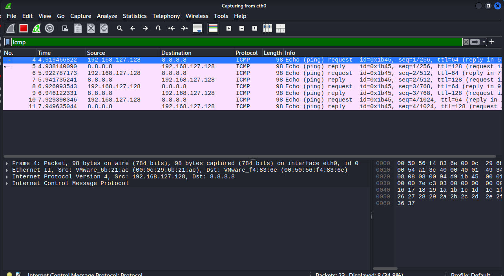
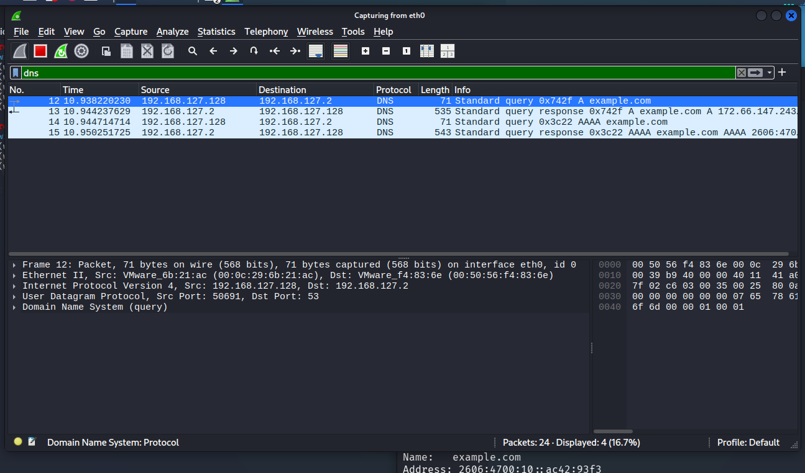
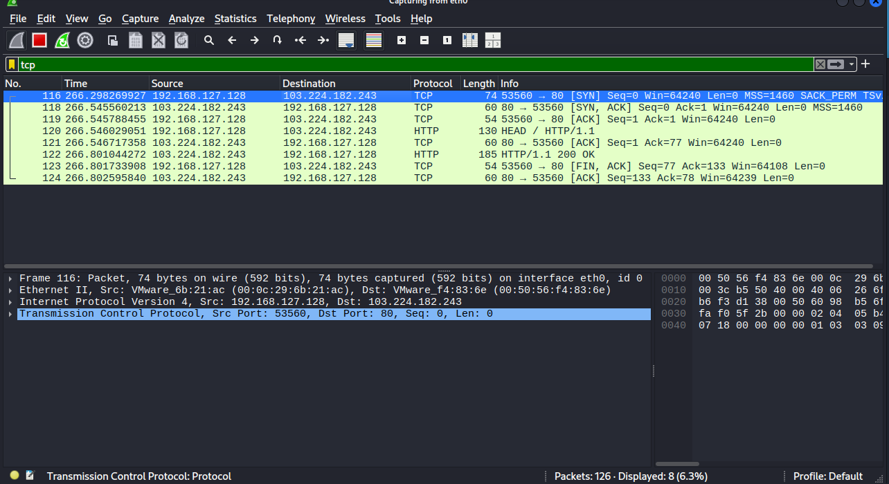

# Task 5: Capture and Analyze Network Traffic Using Wireshark

## 1. Objective

The objective of this task is to capture live network packets with Wireshark, apply display filters, and identify common network protocols. This exercise demonstrates basic packet analysis and how traffic captures can help with network troubleshooting.

## 2. Tools and Environment

- **Wireshark:** Packet capture and protocol analysis tool
- **Command-line utilities:** `ping`, `nslookup`, and `curl`
- **Capture interface:** `eth0`
- **Local capture address shown in the screenshots:** `192.168.127.128`

> Perform packet captures only on devices and networks you own or are authorized to monitor.

## 3. Procedure

1. Opened Wireshark and selected the active network interface, `eth0`.
2. Started a packet capture.
3. Generated ICMP traffic with `ping`, DNS traffic with `nslookup`, and web traffic with `curl`.
4. Applied the display filters `icmp`, `dns`, and `tcp` to isolate and inspect each protocol.
5. Examined packet source, destination, protocol, length, and the packet details pane.
6. Captured screenshots of the filtered results for evidence.

## 4. Protocol Analysis

### 4.1 ICMP — Ping traffic

**Display filter:** `icmp`

**Explanation of Image 1:** The screenshot shows ICMP Echo (ping) request and reply packets between `192.168.127.128` and `8.8.8.8`. The requests are sent by the local host, and the replies return from the destination. This indicates that the ping exchange received responses during the capture. The packet details pane also shows the selected packet's IPv4 and ICMP fields.

**Observation:** ICMP is used for network diagnostics, including reachability checks. Echo requests ask for a response, while Echo replies report that the destination responded.

### 4.2 DNS — Domain name resolution

**Display filter:** `dns`

**Explanation of Image 2:** The screenshot shows DNS queries from `192.168.127.128` to the DNS resolver at `192.168.127.2`, followed by DNS responses. Queries for the A and AAAA records of `example.com` are visible. An A record maps a name to an IPv4 address, while an AAAA record maps a name to an IPv6 address. The packet details pane identifies the selected packet as a DNS query carried over UDP with destination port 53.

**Observation:** DNS translates domain names into address information so applications can locate services. The screenshot includes both queries and responses.

### 4.3 TCP — Web connection traffic

**Display filter:** `tcp`

**Explanation of Image 3:** The screenshot shows TCP traffic between `192.168.127.128` and `103.224.182.243`. The visible entries include a TCP SYN, SYN/ACK, and ACK sequence, which is the three-way handshake used to establish a TCP connection. The capture also labels HTTP traffic, including a `HEAD / HTTP/1.1` request and an `HTTP/1.1 200 OK` response. This is evidence of an HTTP exchange in the captured traffic.

**Observation:** TCP provides reliable, ordered delivery and establishes a connection before exchanging application data. In this capture, HTTP is visible over TCP port 80. Unlike HTTPS, plain HTTP does not encrypt its application data, so avoid sending sensitive information over it.

## 5. Wireshark Display Filters Used

| Filter | Purpose |
|---|---|
| `icmp` | Displays ICMP packets, including ping requests and replies |
| `dns` | Displays DNS queries and responses |
| `tcp` | Displays TCP packets, including connection setup and data exchange |

Display filters only change which packets are shown; they do not delete other packets from the capture.

## 6. Findings

- ICMP Echo requests and replies were observed between the local host and `8.8.8.8`.
- DNS queries and responses for `example.com` were observed.
- TCP connection packets and an HTTP request/response were observed.
- The screenshots show how display filters make it easier to isolate protocols and inspect packet fields.

## 7. Troubleshooting Note

If a filter such as `tcp` shows no results, the current capture may not contain packets matching that filter, or the wrong interface may have been selected. Start a new capture on the active interface and generate suitable traffic. For this task, the supplied TCP screenshot shows matching packets.

## 8. Conclusion

This task provided practical experience capturing network traffic with Wireshark and identifying ICMP, DNS, and TCP. It also demonstrated an HTTP request and response and showed how protocol filters and packet details can support basic connectivity troubleshooting.

## 9. Deliverables

- `task5_capture.pcap` — export your actual Wireshark capture to this repository.
- `report.md` — optional separate report with the protocol observations.
- `screenshots/icmp.png` — ICMP packet evidence.
- `screenshots/dns.png` — DNS packet evidence.
- `screenshots/tcp.png` — TCP/HTTP packet evidence.

**Important:** The screenshots are evidence of the displayed packets, but they are not a substitute for the `.pcap` file. Save your own capture in Wireshark and add it as `task5_capture.pcap` before submitting.
